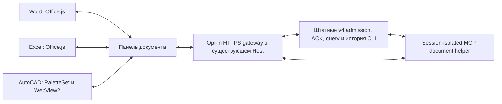

# Word, Excel и AutoCAD: живые документы и общий ZCODE

Объём: общий opt-in мост в существующем desktop Host, инструменты MCP для новых сессий, чтение/переход/предложение/применение через адаптер открытого документа. Работающий экземпляр ZCODE, его процессы и профиль при разработке не изменяются. Сборка и проверки не вызывают модель.

## Владельцы и контракты

CLI владеет принятыми командами, исполнением, разрешениями и историей. Gateway владеет только подключениями, связями документа с сессиями и маршрутизацией живых инструментов. Word/Excel/AutoCAD владеют содержимым, включая несохранённые изменения. Адаптер выполняет операции в API приложения; никогда не редактирует открытый DOCX/XLSX/DWG файловыми средствами.

Документ имеет host, documentId, documentInstanceId, имя и необязательный URL/path. Project binding задаётся явно. Путь или имя не заменяют identity. Каждая связь имеет connection generation. Snapshot содержит host, instance, target и структурированные данные, которые сравниваются целиком перед записью. После переключения/закрытия документа старый запрос отказывается. При переподключении можно заново прочитать выбор того же документа; старый target или proposal нельзя применять к новому instance. Сохранение identity в настройках Office добавляет служебные метаданные в документ.

Методы адаптера: readSelection, readTarget, locate, applyEdit. MCP предоставляет read_selection, read_target, locate, propose_edit и edit_status. `propose_edit` возвращает предложение без записи. Применение выполняется отдельной кнопкой панели после проверки актуальности; UI не держит MCP tool call открытым, ожидая пользователя. Операция имеет operationId, target, expected snapshot и ограниченный patch. Один operationId не применяют повторно; потеря ответа после записи означает unknown и проверку результата, а не автоматический повтор.

Обычный чат документа и независимые обсуждения имеют разные sessionId. Независимая сессия получает project binding, имя/identity/path документа, выбранный snapshot и вопрос; история родителя не копируется. Side conversation создаётся штатным createSelectionSideSession от родителя. Существующим живым сессиям нельзя незаметно добавить MCP: runtime startup config неизменяем. Новый document helper добавляется к полному списку существующих MCP серверов с isolation=session; helper не является вторым агентом.

HTTPS/WSS endpoint слушает loopback и включается только явным локальным config. Клиент получает ограниченные методы после pairing; browser не задаёт MCP executable/env, trusted Host role или чужой workspace/session. Gateway использует отдельный web-remote-replayable connection scope. Native v4 frames не заменяются придуманным token stream. Переподключение требует snapshot/resync, неизвестный ACK — query по commandId. Provider credentials остаются в Host/CLI.

## Word

Чтение выбранного текста создаёт opaque anchorId и tracked native Range. Поиск одинаковой цитаты не заменяет исходную область. Удерживаются не более 100 диапазонов; закрытие панели или вытеснение якоря требует нового выделения. Переход выделяет закреплённый диапазон. Замена plain text сверяет текст перед записью и включает штатный change tracking; отдельное замечание создаётся через native comment. Таблицы и картинки не заменяются plain text операцией; сохранение исходного форматирования не обещается. Предыдущее состояние tracking восстанавливается, если оно ещё TrackAll; ошибка восстановления отображается отдельно от результата записи. Office.js не гарантирует атомарный CAS, исключение одновременной правки автора или универсальную Undo-группу. Требуется WordApi 1.4. Лимит текста 20000 символов и полного snapshot 64 KiB.

## Excel

Snapshot содержит worksheet identity, address, значения, формулы и отображаемый текст отдельно. Максимум 1000 ячеек за чтение; весь лист автоматически не сканируется. readTarget читает явно указанный bounded range; locate выделяет его. Запись — прямоугольный patch values или formulas с совпадающими размерами и проверкой снимка. Не смешивать локализованные формулы с invariant API formulas. При вставке строк/переименовании листа/изменении содержимого разрешение target проверяется заново. VBA, COM и произвольные скрипты не исполняются этим адаптером.

Полный snapshot ограничен 64 KiB. Перед записью требуется ExcelApi 1.13 и проверяются protection, merged areas, savedAsArray и hasSpill. Объединённые, защищённые и массивные диапазоны отказываются без записи. Проверка содержимого повторяется после проверки этих свойств; coauthor CAS не является атомарным.

## AutoCAD 2024

Отдельный net48/x64 plug-in с PaletteSet и WinForms WebView2. Статические файлы поставляются локально через virtual-host mapping, WebView имеет собственную writable user-data папку. Разрешены только известные native messages; интерактивный выбор запускается после возврата из WebMessageReceived в command context.

Snapshot: документ/instance, INSUNITS без догадки о миллиметрах, frame=WCS, handle, entity type, layer, свойства и поддержанная геометрия. Начальные типы LINE/CIRCLE/ARC/LWPOLYLINE/TEXT/MTEXT; другие возвращают metadata и unsupported geometry. Максимум 100 объектов и 1000 вершин. OCS/normal/elevation учитываются; WCS не означает географическую CRS. Переход повторно разрешает handle в том же документе и выбирает объекты. Начальная запись — изменение слоя существующих выбранных объектов; слой должен существовать и быть доступен, xref/proxy и locked layer отказываются. Проверка и commit выполняются под DocumentLock в одной transaction. Произвольные LISP/command strings не являются document tools.

## Границы проверки

Config разделяет сертификат сервера `certPath` и доверенный корневой Office CA `caPath`. MCP helper проверяет TLS через `ca.crt`; обязательная проверка сертификата сохраняется. Отдельная fixture проверяет настоящий Node HTTPS канал, MCP stdio, binding authorization и UTF-8 ответ без подключения к ZCODE.

Native CAD очередь привязана к activation/navigation epoch: смена или закрытие активного чертежа и перезагрузка страницы отменяют ещё не начатые операции. Команда не активирует старый чертёж. Snapshot сравнивает числовые значения независимо от Integer/Float JSON tags; точность геометрии не заменяется допуском. Общий размер snapshot ограничен 64 KiB. Проверка актуальности охватывает опубликованные поля, а не все возможные свойства Entity; полный текст TEXT/MTEXT проверяется дополнительным fingerprint даже при сокращённом отображении.

Неизвестное подтверждение удерживает исходный commandId через reconnect; при доступном localStorage — также через reload. Панель хранит только ключи команд, не тексты и не accepted queue; до query/явной проверки пользователем новая отправка блокируется. Gateway прекращает admission при disconnect, ограничивает очереди и сообщает saturation/drain штатному scope. Shutdown gateway является ограниченной фазой закрытия Host. MCP cancellation прекращает HTTP callback; уже начатый native read/locate может завершиться, но запись через MCP отсутствует.

Панель показывает нативную проекцию текущего окна истории, инструменты, reasoning и разрешения. Формы AskUserQuestion используют общий чистый builder ответов ZCODE; черновики и фокус сохраняются при streaming. ПКМ и кнопки панели проходят одну admission boundary. Полный React Root/SessionPane не монтируется: UI оформления Word/Excel остаётся родным, дополнительные workers не создаются. История предыдущих страниц, расширенные настройки workflow и все desktop dialogs пока не перенесены.

Предложения и до 100 terminal receipts удерживаются в памяти текущего подключения. После закрытия/переподключения edit_status старого предложения недоступен; агент должен снова прочитать документ. Постоянного хранилища diff или предложения нет.

Проверяются contracts, отказ старому instance, duplicate apply, changed target, cancel, document switch/close, disconnect, ACK/query, сохранение исходных MCP настроек, MCP JSON-RPC и реальная компиляция plug-in против установленного AutoCAD. Изолированные runtime/fixtures не используют живой профиль и не вызывают модель. Подключение к рабочему ZCODE и end-to-end модельная приёмка выполняются отдельно после его освобождения. Наличие bounded document tools не ограничивает автоматически сторонние filesystem/MCP инструменты агента; не заявлять глобального единственного writer без отдельной политики этих инструментов.

Статус отдельных возможностей и фактическая приёмка перечисляются в README каждого адаптера. Полные истории и диффы не копируются в документы: сохраняются ссылки/якоря; Word revisions и Git остаются штатными средствами изменения.

## Следующий отдельный запрос: справочная карта для агента

После приёмки интеграции исследовать компактное дерево возможностей Word, Excel и AutoCAD: объекты → операции → ограничения → минимальный пример. Это справочная система для агента, чтобы типовые API-вызовы не требовали веб-поиска. Рассмотреть requirement sets Office, Autodesk managed reference, MCP tools/resources и готовые аналоги. Предпочтительно выдавать краткий индекс при старте, а сведения о выбранной ветке — по запросу; версии и фактически поддержанные операции должны совпадать с адаптером. Сам справочник сейчас не реализуется, сборка и исследование аналогов — отдельная задача пользователя.
