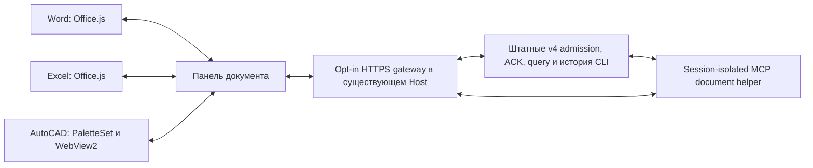

# Word, Excel и AutoCAD: живые документы и общий ZCODE

Цель — одна поддерживаемая версия ZCODE из форка, с общим агентным ядром и интерфейсами в приложениях документов. Текущие задачи, владельцы и границы проверенной приёмки: [IMPLEMENTATION-PLAN.md](IMPLEMENTATION-PLAN.md), [IMPLEMENTATION-CHECKLIST.md](IMPLEMENTATION-CHECKLIST.md). Этот SRS описывает контракты и поддержанный объём; наличие кода не означает, что все GUI/модельные сценарии уже проверены.

Объём: общий opt-in мост в существующем desktop Host, инструменты MCP для новых сессий, чтение/переход/предложение/применение через адаптер открытого документа. Работающий экземпляр ZCODE, его процессы и профиль при разработке не изменяются. Сборка и проверки не вызывают модель.

## Владельцы и контракты

CLI владеет принятыми командами, исполнением, разрешениями и историей. Gateway владеет только подключениями, связями документа с сессиями и маршрутизацией живых инструментов. Word/Excel/AutoCAD владеют содержимым, включая несохранённые изменения. Адаптер выполняет операции в API приложения; никогда не редактирует открытый DOCX/XLSX/DWG файловыми средствами.

Документ имеет host, documentId, documentInstanceId, имя и необязательный URL/path. Project binding задаётся явно. Путь или имя не заменяют identity. Каждая связь имеет connection generation. Snapshot содержит host, instance, target и структурированные данные, которые сравниваются целиком перед записью. После переключения/закрытия документа старый запрос отказывается. При переподключении можно заново прочитать выбор того же документа; старый target или proposal нельзя применять к новому instance. Сохранение identity в настройках Office добавляет служебные метаданные в документ.

Методы адаптера: readSelection, readTarget, locate, applyEdit. MCP предоставляет read_selection, read_target, locate, propose_edit и edit_status. `propose_edit` возвращает предложение без записи. Применение выполняется отдельной кнопкой панели после проверки актуальности; UI не держит MCP tool call открытым, ожидая пользователя. Операция имеет operationId, target, expected snapshot и ограниченный patch. Один operationId не применяют повторно; потеря ответа после записи означает unknown и проверку результата, а не автоматический повтор.

Обычный чат документа и независимые обсуждения имеют разные sessionId. Независимая сессия получает project binding, имя/identity/path документа, выбранный snapshot и вопрос; история родителя не копируется. Side conversation создаётся штатным createSelectionSideSession от родителя. Существующим живым сессиям нельзя незаметно добавить MCP: runtime startup config неизменяем. Новый document helper добавляется к полному списку существующих MCP серверов с isolation=session; helper не является вторым агентом.

HTTPS/WSS endpoint слушает loopback и включается только явным локальным config. Клиент получает ограниченные методы после pairing; browser не задаёт MCP executable/env, trusted Host role или чужой workspace/session. Gateway использует отдельный web-remote-replayable connection scope. Native v4 frames не заменяются придуманным token stream. Переподключение требует snapshot/resync, неизвестный ACK — query по commandId. Provider credentials остаются в Host/CLI.

### Заморозка границ диалога (T-02..T-05, дизайн)

Ниже заморожены пять проектных решений публичной границы документного диалога. Это дизайн без живой приёмки: код следующих волн выводится только из этих решений. Ссылки `path:line` указывают на текущий исходник: файлы без правок волны 1 закреплены за HEAD `aa8236cf`; файлы с уже принятыми правками волны 1 (`packages/desktop/src/main/specDetachedPanels.ts`, `packages/desktop/src/host/documentGatewayAgent.ts`, `packages/ui/src/spec-document/{specWindowBridge,useSpecDetachedPanels,useSpecDiscussion,specDocumentPresentationState}.ts`, `SpecDetachedPanelRoot.tsx`) цитируются по принятому рабочему diff, который root интегрирует следующим коммитом — после интеграции все ссылки разрешаются на новом HEAD. Коллизии и недостающие границы перечислены в [ARCHITECTURE-REVIEW.md](ARCHITECTURE-REVIEW.md).

**Один композер: перенос внутри desktop, наблюдение между поверхностями.** Действуют два разных режима. (1) Перенос (transfer) — внутри desktop между главным окном и отсоединённой панелью: панель физически смонтирована ровно в одном рендерере, второй редактируемый композер не существует. Detach и Return отказывают при незавершённой IME-композиции или несохранённых вложениях (`useSpecDetachedPanels.ts:96-101`, `SpecDetachedPanelRoot.tsx:87-94`); ACK пересылки ждёт явный сигнал завершения пассивной очистки панели, а не таймер (`specWindowBridge.ts:26-51`, `:74-96`); крах рендера ребёнка в Return-рукопожатии откатывается немедленным разрушением окна и возвратом панели источнику без ослабления таймаутов (`specDetachedPanels.ts:131-139`, `:264-272`); черновик защищён токеном писателя — опекающая панель с retired-токеном не перезаписывает черновик принявшей панели (`specDocumentPresentationState.ts:120-167`, `:178-179`). (2) Наблюдение (observation) — между desktop и панелью документа переноса нет и не заявляется: панель документа не отбирает композер у окна, окно не отбирает у панели. Обе поверхности — независимые подключения к одной CLI admission; единственный сериализатор — per-session gate `CommandInbox` (`apps/zcode-cli/packages/bootstrap/src/zcode-protocol-v4/command-inbox.ts:107-131`), вторая принятая очередь не создаётся (`documentGatewayAgent.ts:25-44` — только маршрутизация в рамках binding). Каждая поверхность обязана показывать нативный вердикт admission (busy/queued/running) и локально блокировать новую отправку при неразрешённых командах (`packages/ui/src/document-host/client.ts:260-261`); черновики локальны для поверхности, UI-гард — не runtime-lock (`useSpecDiscussion.ts:62`). Cross-surface политика следующих волн выражается атрибуцией поверхности в command envelope на стороне CLI admission (решение B2 в ARCHITECTURE-REVIEW.md); до её появления композиция из разных поверхностей в одну сессию упорядочивается прибытием в admission и видима как нативный вердикт.

**Маркер документных сессий.** Единственный durable-маркер документной сессии — persisted binding самого gateway: allow-list `binding.sessions` плюс кольцо `binding.creations` (ограничено 512, `documentGatewayProtocol.ts:43-52`; запись и рост — `documentGatewayAgent.ts:203-217`). Маркер в состояние CLI-сессии не пишется: сессией и её стартовым config владеет CLI runtime, второй писатель создал бы вторую истину, а ретроактивное MCP-подключение к живой сессии запрещено (ADR [001](../architecture/decisions/001-document-host-adapters.md); панель не может принести свой `mcpServers` — `documentGatewayAgent.ts:164-172`, шлюз сам собирает полный список с `isolation=session`, `:173-201`). Следствия (принятые): список задач desktop не отличает документную сессию визуально — пользовательская метка остаётся штатным `renameSession` (`:158`); сессия, созданная вне панели, не входит в binding — членство меняется только созданием через панель, acknowledged delete или отзывом; восстановление неразрешённых созданий идёт query-по-commandId с записью в binding (`client.ts:226-238`, `documentGatewayAgent.ts:118-142`).

**Механизм отзыва сессий: failure-driven (выбран), не sessions-index подписка.** Отзыв из binding происходит по факту структурированного отказа: subscribe-ошибка с `fault.subscribe.sessionNotFound` (`documentGatewayAgent.ts:45-51`, `:83-86`) и rejected ACK с `reasonCode=proto.sessionNotFound` на session-команду (`:220-230`) удаляют id и персистят; deleteSession, ack-нутый через панель, отзывался и раньше (`:218-219`). Прочие отказы (staleRevision, сбой исполнения) не отзываются — иначе ещё живую сессию можно ошибочно изъять из binding. Компромиссы зафиксированы: (плюс) не нужен новый событийный канал services и не появляется второе хранилище сессий; ошибки остаются видимыми pane (исходный error/ACK пробрасывается); отзыв ограничен однозначными сигналами. (минус) мёртвый id живёт в восстановленном списке до первого касания — `bind` возвращает `binding.sessions` как есть (`documentGateway.ts:303-308` на HEAD), поэтому панель обязана показать «поток больше не существует» при первом отказе открытия, а не молча удалять строку. Eager-подписка на sessions-index (отзыв по событиям lifecycle из services) остаётся отложенной опцией только при появлении такого публичного канала (B3 в ARCHITECTURE-REVIEW.md); собственный session store в gateway не создаётся — это была бы вторая истина вопреки A-04.

**Паритет: старая история, вложения, выбор модели — нативно или явно отсутствует с причиной.** Фиктивные контролы и demo-ответы запрещены (правило 6 плана). (1) Старая история: цель — явная «загрузить старее» через уже разрешённый метод `conversationRowsRangeV4` (курсор `beforeRowId`, limit 1..200, `documentGatewayAgent.ts:102-117`) по публичному транспорту; desktop уже ходит этим же нативным вызовом (`packages/ui/src/v4/agentConversationTransport.ts:375-381`, `conversationProjectionStore.ts:1041-1053`). Eager-копия полной истории в панель не планируется. Пока код не добавлен, панель обязана явно показывать отсутствие с причиной (absent-with-reason): «старая история не загружена в панели; откройте сессию в ZCODE» — сейчас `pane.js:274` рендерит только `snapshot.rows.window` и молчит о границе окна. (2) Вложения: в этой версии границы панель документа файловые вложения не принимает. Причина: несохранённое вложение держит renderer-owned upload/preview ресурсы композера desktop (`ConversationComposer.tsx:2339`; перенос отказывает при pending upload — `useSpecDetachedPanels.ts:96-101`), а каналом контекста панели остаётся явный ограниченный фрагмент из `readSelection` (`pane.js:36-45`, `:177-179`). Обязательное указание отсутствия: «вложения недоступны в панели документа; используйте ZCODE» — не мёртвая и не фиктивная кнопка. (3) Модель/режим: режим переключается нативно (`switchCollaborationMode`, `pane.js:205-208`); модель отображается read-only из снапшота сессии с причиной «настройки берутся из ZCODE» (`pane.js:241-245`). Шлюз уже разрешает `switchModelConfig` в envelope (`documentGatewayAgent.ts:159`), но контрол панели — задача следующей волны с переиспользованием публичного контрола выбора модели; до его появления обязательно указание отсутствия с причиной. Отказ удаления с причиной в desktop уже выведен из того же источника, что и `canRemove` (`useSpecDiscussion.ts:36-59`, `:385-394`) — этот же принцип «одно происхождение причины» применяется ко всем состояниям отсутствия и отказа панели.

**Очистка якорей контекста при переподключении.** Заморожен контракт: панельные якоря контекста — `quotes` (per-session фрагменты), `selected`, `contextPending` и ревизии `selectionRevision` — эфемерны в пределах одного connection generation и одного documentInstanceId (состояние объявлено в `pane.js:14-22`, читается в `:36-45`, потребляется композером в `:177-188`). (1) При reconnect панель обязана очистить `quotes`/`selected`/`contextPending` и не переносить фрагмент в следующую отправку: каждый `connect` создаёт новое поколение (`documentGateway.ts:243-264` на HEAD), смена документа/проекта возможна только через reconnect (`:269-270`), а текущий `pane.js:177` взял бы `quotes.get(session) ?? (contextPending ? selected : undefined)` и молча приложил выделение, сделанное до разрыва — возможно, из другого документа — к сессии после переподключения. (2) При смене documentInstanceId внутри живого подключения адаптер уже отказывает в записи/переходе по старым target и proposal (`office-adapter.js:77-80`; `review.ts:19-23`, `:72-74`, `:96-101`; pruning по generation — `:83-91`), но контекст промпта — путь чтения: его защищает только очистка на стороне панели. (3) После очистки новая отправка требует явного нового `readSelection`; повторное применение proposal старого поколения невозможно. `pendingIntent`-повтор обсуждения после reconnect обязан заново прочитать выделение, а не использовать старое.

**Производные задачи следующих волн (только из этой заморозки).** (a) T-02 код: атрибуция поверхности в command envelope на CLI admission + единый рендеринг нативного admission-вердикта в desktop и панели (B2). (b) T-03 код: «загрузить старее» в панели через `conversationRowsRangeV4`; указания отсутствия с причиной для вложений и выбора модели; контрол выбора модели с переиспользованием публичного контрола. (c) T-04 код: очистка якорей при reconnect/смене instance в `pane.js` + fixture «выделение до disconnect не появляется в отправке после reconnect»; видимое состояние «поток больше не существует» при первом отказе восстановленной сессии. Никакие другие изменения границы из этих решений не выводятся.

## Word

Чтение выбранного текста создаёт opaque anchorId и tracked native Range. Поиск одинаковой цитаты не заменяет исходную область. Удерживаются не более 100 диапазонов; закрытие панели или вытеснение якоря требует нового выделения. Переход выделяет закреплённый диапазон. Замена plain text сверяет текст перед записью и включает штатный change tracking; отдельное замечание создаётся через native comment. Таблицы и картинки не заменяются plain text операцией; сохранение исходного форматирования не обещается. Предыдущее состояние tracking восстанавливается, если оно ещё TrackAll; ошибка восстановления отображается отдельно от результата записи. Office.js не гарантирует атомарный CAS, исключение одновременной правки автора или универсальную Undo-группу. Требуется WordApi 1.4. Лимит текста 20000 символов и полного snapshot 64 KiB.

## Excel

Snapshot содержит worksheet identity, address, значения, формулы и отображаемый текст отдельно. Максимум 1000 ячеек за чтение; весь лист автоматически не сканируется. readTarget читает явно указанный bounded range; locate выделяет его. Запись — прямоугольный patch values или formulas с совпадающими размерами и проверкой снимка. Не смешивать локализованные формулы с invariant API formulas. При вставке строк/переименовании листа/изменении содержимого разрешение target проверяется заново. VBA, COM и произвольные скрипты не исполняются этим адаптером.

Полный snapshot ограничен 64 KiB. Перед записью требуется ExcelApi 1.13 и проверяются protection, merged areas, savedAsArray и hasSpill. Объединённые, защищённые и массивные диапазоны отказываются без записи. Проверка содержимого повторяется после проверки этих свойств; coauthor CAS не является атомарным.

## AutoCAD 2024

Отдельный net48/x64 plug-in с PaletteSet и WinForms WebView2. Статические файлы поставляются локально через virtual-host mapping, WebView имеет собственную writable user-data папку. Разрешены только известные native messages; интерактивный выбор запускается после возврата из WebMessageReceived в command context.

Snapshot: документ/instance, INSUNITS без догадки о миллиметрах, frame=WCS, handle, entity type, layer, свойства и поддержанная геометрия. Начальные типы LINE/CIRCLE/ARC/LWPOLYLINE/TEXT/MTEXT; другие возвращают metadata и unsupported geometry. Максимум 100 объектов и 1000 вершин. OCS/normal/elevation учитываются; WCS не означает географическую CRS. Переход повторно разрешает handle в том же документе и выбирает объекты. Начальная запись — изменение слоя существующих выбранных объектов; слой должен существовать и быть доступен, xref/proxy и locked layer отказываются. Проверка и commit выполняются под DocumentLock в одной transaction. Произвольные LISP/command strings не являются document tools.

## Границы проверки

Config разделяет сертификат сервера `certPath` и доверенный корневой Office CA `caPath`. MCP helper проверяет TLS через `ca.crt`; обязательная проверка сертификата сохраняется. Отдельная fixture проверяет настоящий Node HTTPS канал, MCP stdio, binding authorization и UTF-8 ответ без подключения к ZCODE.

Native CAD очередь привязана к activation/navigation epoch: смена или закрытие активного чертежа и перезагрузка страницы отменяют ещё не начатые операции. Команда не активирует старый чертёж. Snapshot сравнивает числовые значения независимо от Integer/Float JSON tags; точность геометрии не заменяется допуском. Общий размер snapshot ограничен 64 KiB. Проверка актуальности охватывает опубликованные поля, а не все возможные свойства Entity; полный текст TEXT/MTEXT проверяется дополнительным fingerprint даже при сокращённом отображении.

Неизвестное подтверждение удерживает исходный commandId через reconnect; при доступном localStorage — также через reload. Панель хранит только ключи команд, не тексты и не accepted queue; до query/явной проверки пользователем новая отправка блокируется. Gateway прекращает admission при disconnect, ограничивает очереди и сообщает saturation/drain штатному scope. Shutdown gateway является ограниченной фазой закрытия Host. MCP cancellation прекращает HTTP callback; уже начатый native read/locate может завершиться, но запись через MCP отсутствует.

Панель показывает нативную проекцию текущего окна истории, инструменты, reasoning и разрешения. Формы AskUserQuestion используют общий чистый builder ответов ZCODE; черновики и фокус сохраняются при streaming. ПКМ и кнопки панели проходят одну admission boundary. Полный React Root/SessionPane не монтируется: UI оформления Word/Excel остаётся родным, дополнительные workers не создаются. История предыдущих страниц, расширенные настройки workflow и все desktop dialogs пока не перенесены.

Предложения и до 100 terminal receipts удерживаются в памяти текущего подключения. После закрытия/переподключения edit_status старого предложения недоступен; агент должен снова прочитать документ. Постоянного хранилища diff или предложения нет.

Проверяются contracts, отказ старому instance, duplicate apply, changed target, cancel, document switch/close, disconnect, ACK/query, сохранение исходных MCP настроек, MCP JSON-RPC и реальная компиляция plug-in против установленного AutoCAD. Изолированные runtime/fixtures не используют живой профиль и не вызывают модель. Подключение к рабочему ZCODE и end-to-end модельная приёмка выполняются отдельно после его освобождения. Наличие bounded document tools не ограничивает автоматически сторонние filesystem/MCP инструменты агента; не заявлять глобального единственного writer без отдельной политики этих инструментов.

Статус отдельных возможностей и фактическая приёмка перечисляются в README каждого адаптера. Полные истории и диффы не копируются в документы: сохраняются ссылки/якоря; Word revisions и Git остаются штатными средствами изменения.

## Следующий отдельный запрос: справочная карта для агента

После приёмки интеграции исследовать компактное дерево возможностей Word, Excel и AutoCAD: объекты → операции → ограничения → минимальный пример. Это справочная система для агента, чтобы типовые API-вызовы не требовали веб-поиска. Рассмотреть requirement sets Office, Autodesk managed reference, MCP tools/resources и готовые аналоги. Предпочтительно выдавать краткий индекс при старте, а сведения о выбранной ветке — по запросу; версии и фактически поддержанные операции должны совпадать с адаптером. Сам справочник сейчас не реализуется, сборка и исследование аналогов — отдельная задача пользователя.
