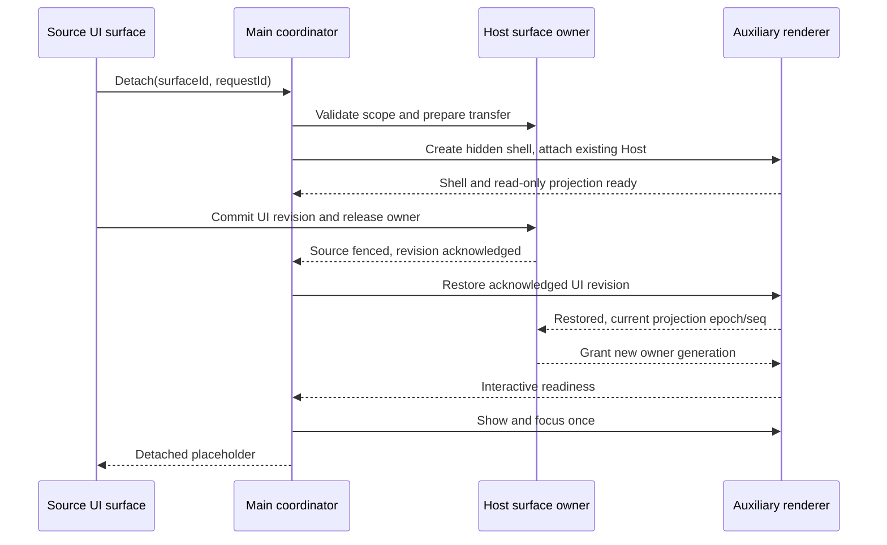

# Refactoring plan: desktop-wide chat and discussion windows

Date: 2026-10-15. Inspected source baseline: `e181522b`, branch `dev`.
Status: repair implementation in progress; full product GUI acceptance remains OPEN.

2026-10-15 repair amendment: ADR 002 now selects option B, a controlled same-origin
native Electron window with the existing stable React portal. The independent-renderer
option A scaffold was reviewed and not integrated because its live surface/port handling
was incomplete. Main owns native placement, the original React/Host tree remains the
only conversation owner. The handoff/ACK/fencing protocol below belongs to the earlier
option A proposal and is not a requirement to duplicate session ownership in option B.
The user explicitly authorized launch/restart after shutting ZCode down. Isolated proof
passed real React state/input, child-document Radix placement, three simultaneous native
windows, OS close/Return, owner hide/reveal and 20 cycles with no remaining child windows.
Product Lexical composer, real model picker and session UI acceptance remain separate gates.
Root owns scope and integration. Traceability: U-06, U-07, D-05, U-01, P-03
and the bounded W-01..W-05 regression cases below.
[Implementation checklist](IMPLEMENTATION-CHECKLIST.md),
[Russian acceptance requirements](ACCEPTANCE-CHECKLIST.md),
[architecture decision](../architecture/decisions/002-desktop-floating-conversation-windows.md).

Language policy: prompts, plans and architecture decisions are in English.
User-facing requirements and acceptance checklists are in Russian.
This translation preserves the reviewed scope, ownership and acceptance gates.

## 1. Outcome and scope

Live UX correction (2026-10-15): on Desktop, the discussion Expand control opens the
native OS window, rather than the legacy document-bounded floating panel. Use one
clear entry; native presentation has no inner drag/resize/dock handles or fixed panel
minimum size. Return restores the same discussion. Web retains its in-app presentation.

Implement real nonmodal OS windows for document discussions and main chat.
Users can move them beyond the document and ZCODE boundaries onto any connected
monitor, resize/minimize them and return their contents to the application.
Default topmost applies over ordinary windows; do not bypass UAC, the secure
desktop or OS restrictions. Use accessible icon controls with descriptive labels.

Desktop must not depend on Document PiP. Remove its forced shared-slot limitation:
chat and discussions from different document tabs may remain detached simultaneously.
Opening the same logical surface again reveals the existing window.
Minimum acceptance: one chat and two discussion windows from two document tabs.
This must not increase agent execution concurrency.

Discussion windows remain bound to their original workspace, document and thread
collection. Main-window project/tab changes must not retarget them. Thread selection
inside a discussion window remains available; inactive threads remain hidden.
Chat windows retain the detached session, independently of later navigator selection.
Return restores the original identity.

Preserve engine, protocol, permissions, command admission, provider/auth, project
navigation, Markdown workflow, both layouts and rendering optimizations.
The RETIREMENT-2 exception covers only this new chat/discussion window mechanism.
Do not restore old project-window commands, toolbar or feature flag.
Office/AutoCAD remain retired. Web PiP may remain a separate web adapter;
its limitations must not constrain desktop.

The current request authorizes planning and requirements documentation only.
It does not authorize launching, restarting or instrumenting the application,
accessing its live profile, installation, paid requests or automatic merging.

## 2. Verified cause and implementation boundaries

| Current path                                                                      | Planned responsibility                                                                                          |
| --------------------------------------------------------------------------------- | --------------------------------------------------------------------------------------------------------------- |
| `packages/ui/src/spec-document/SpecDocumentPane.tsx`, `specDiscussionGeometry.ts` | Preserve docked/in-app geometry; do not use document dimensions as OS-window bounds.                            |
| `packages/ui/src/spec-document/specPopoutWindow.ts`                               | Separate native desktop capability from web PiP.                                                                |
| `packages/ui/src/spec-document/specPopoutRegion.tsx`                              | Explicit desktop state transfer; no promise of DOM adoption across independent renderers.                       |
| `packages/ui/src/app-shell/WorkspaceShellLayout.tsx`, `AnimatedSidePanePanel.tsx` | Icons, placeholders, source restoration and independence from current tab selection.                            |
| `packages/ui/src/v4/SessionPane.tsx`, `ConversationTimeline.tsx`                  | Single transferred-composer owner; UI-state export/restore; preserve control/visibility duties.                 |
| `packages/shared/src/platform.ts`, `specWindows.ts`                               | Inventory surviving types; expose a narrow public desktop capability without reviving the whole retired bridge. |
| `packages/desktop/src/main/desktopWindowLifecycle.ts`                             | Ordinary lifecycle creates/disposes a Host; auxiliary windows must not reuse it unchanged.                      |
| `packages/desktop/src/main/index.ts`, `primaryWindowCoordinator.ts`               | Auxiliary coordinator; primary-window lookup must exclude auxiliary windows.                                    |
| `packages/desktop/src/host/windowHostAttachmentRegistry.ts`                       | Existing Host attachment with validated local/remote scope and generation.                                      |
| `packages/desktop/src/renderer/src/desktopPlatform.ts`, preload and bootstrap     | Typed capability and minimal window entrypoint, not a second full project shell.                                |

`desktopWindowLifecycle.ts` already uses `AttachServicePort` with
`desktop-continuous` to reattach to a live Host. This is a routing example,
not finished auxiliary support. Auxiliary attach failure must not enter a
fallback that kills/recreates the Host. Web remote retains
`web-remote-replayable`; do not copy its adapter with the wrong clientMode.

Proposed filenames, not existing implementation:
`desktopConversationWindows.ts` (Main),
`conversationSurfaceTransfer.ts` (public DTOs),
`conversationSurfaceOwnerService.ts` (Host/service boundary),
`conversation-window.html` and a minimal renderer entrypoint.
Determine managed-module boundaries through architecture context before creation.

## 3. Architecture and single owners

Use a dedicated auxiliary `BrowserWindow` with a minimal renderer attached
to the existing Host. It is nonmodal and does not depend on main-window visibility.
Automatic topmost must not steal focus on every token or notification.
[Electron BrowserWindow](https://www.electronjs.org/docs/latest/api/browser-window).

| State                                                                     | Sole owner                                                                                     |
| ------------------------------------------------------------------------- | ---------------------------------------------------------------------------------------------- |
| Native session/run, accepted commands, history, permission/question facts | Existing runtime/Host; no second agent or queue.                                               |
| OS window, placement transaction, geometry and display selection          | Main coordinator; no business history or accepted commands.                                    |
| Authority to edit/submit from the transferred surface                     | Host/service surface owner with sender-bound generation and acknowledged handoff.              |
| Draft, selection, attachments, find and scroll                            | One active UI owner; latest acknowledged revision in a bounded surface-state service.          |
| Execution and execution configuration                                     | Existing designated control owner; hidden main control remains alive without another composer. |
| Document text, dirty/conflict/save                                        | Existing document owner; no second file editor in a discussion window.                         |

Use an immutable `surfaceId` with a logical binding to owner Host,
workspaceIdentity (path fallback), surface kind and document-tab/binding identity.
Current sessionId/remoteSessionId, draft binding and connection generation belong
to validated scope but must NOT change surfaceId on reconnect or draft-to-session
promotion. Promotion atomically updates binding with the same owner/revision.
Discussion selection changes the authorized target within the document surface,
not the window identity. Generation fences old attachments; it is not a persistent
geometry key. Paths do not replace identity. Host validates scope against the
known attachment; renderers cannot select arbitrary Hosts.

Exclusivity applies to the TRANSFERRED logical surface, not globally to independent
document/web observers of the same session. Exactly one submitting owner exists
before/after successful transfer and at most one during handoff.
After release, reject old-sender commands at the service boundary before existing
native dispatch; disabled UI is insufficient. Accepted commands continue.
Resolve uncertain outcomes through existing query/recovery, without resubmitting
a new request. The surface service is not another command queue.

Version the transfer payload: identities, draft revision/text/selection, completed
attachment references, selected thread, quote/anchor context, scroll anchor
(rowId + offset or following), find query/current match and return layout target.
Do not put credentials, full history, DOM/File objects or secrets in URLs.
Apply existing composer size limits and prune stale generations.
Carry pending/optimistic command IDs as references to existing query/recovery,
not a copied accepted queue. After successful Return and inline-store ACK,
delete transfer buffers. Surface disposal/owner shutdown clears remaining state.
While detached, keep only the latest acknowledged revision, not an unbounded log.

During IME composition or unfinished attachment ingestion, refuse/defer transfer
with a visible reason and preserve source input. Retry is possible after completion.
Never force composition commit or cancel attachment ingestion to move the surface.

## 4. Transfer, return and failure handling

State sequence:
`inline -> preparing -> source-released -> detached -> returning -> inline`.
Every transition includes surfaceId, transactionId, generation, draft revision
and verified sender identity. Requests are idempotent; stale ACKs are ignored.

Shell-ready, content-ready and interactive-ready are separate facts.
Electron `ready-to-show` does not establish session/composer/scroll readiness.
Retain source until the safe handoff point. Failure before release preserves it;
failure after release revokes destination authority and performs acknowledged
rollback. A timeout alone cannot re-enable source: fence the previous destination
first. Report failure; never fabricate readiness or ACK.

Return and OS X run the inverse protocol. Intercept closing; destroy child only
after the restored source acknowledges readiness. If target is unavailable,
retain child with a retry affordance. If the original tab closed or project changed,
restore an addressed target in the original workspace without renaming the session
or losing other tabs. Closing a source tab with a detached discussion first requires
successful Return; cancellation preserves both. Closing a view is never Delete/Stop.

Main minimize/hide must not hide or stop auxiliary windows.
While children exist, main X hides main but retains owner Host and control surface.
Return/application activation reveals it. Explicit Quit uses normal shutdown.
Last auxiliary Return reveals main. A crash of the last child also reveals main
with addressed recovery rather than leaving an invisible Host without usable UI.

After main renderer crash, retain child scope and report control-owner availability
honestly. Do not invent execution configuration. Reattach the recovering main
renderer to the surviving Host without respawn. If Host actually dies, show
disconnected/recovery rather than claiming execution continued.

Crash recovery guarantees the latest ACKNOWLEDGED draft revision, not unacknowledged
keystrokes from a dead renderer. Batching/debouncing requires a defined handoff
flush; do not show saved status before ACK. Normal Detach/Return/X must acknowledge
the full current draft. Recover child from surface state without a model request.
Restart differs from hot recovery: use existing draft persistence and initially
restore inline; next Detach uses saved geometry. Do not automatically start runs.

## 5. Geometry, accessibility and security

- OS drag/resize does not use document `clampDiscussionRect`. Allow negative
  desktop coordinates for monitors left/above primary.
- Persist normal bounds, display hint, scale and maximized state in DIP per
  workspace/surface, separately from in-app rect. Bound persistence frequency.
- Apply work-area recovery at restore/display changes, keeping titlebar and Return
  reachable; do not clamp ordinary dragging to application/document bounds.
  [Electron screen](https://www.electronjs.org/docs/latest/api/screen).
- Text zoom and DPI are independent. Test 100/150/200%, taskbar, maximize/restore,
  sleep/wake and negative monitor coordinates. Small windows scroll while keeping
  composer and controls reachable.
- Alt+Tab/taskbar identify ZCODE, project and chat/document. Activation reveals an
  existing window. Keyboard, clipboard, file dialogs, menus, focus traps and
  permissions target the actual presentation window.
- Control/lifecycle subscriptions remain active while hidden. Heavy presentation
  uses actual placement and document visibility. Source placeholders must not
  retain a hidden Timeline rebuilding per token. Avoid duplicate notifications.
- Trusted packaged entrypoint, existing sandbox/context isolation, Node disabled
  in renderer. Do not weaken web security for portals. Validate sender, scope,
  generation and navigation; reject arbitrary URLs, child popups and foreign IDs.
  [Electron security](https://www.electronjs.org/docs/latest/tutorial/security).
- Windows is the first mandatory acceptance platform. Document other OS capability
  limits; do not present Windows-only checks as cross-platform acceptance.

## 6. Implementation waves and exit gates

Create an isolated worktree from fresh `dev`; record SHA and preserve unrelated
changes. Do not connect it to an active development server.
At most three active subagents; one writer per file; workers do not commit/push.
Root owns shared contracts, specifications and integration. An independent
read-only reviewer checks a stable diff. Merge into the shared branch only after
the user's separate instruction.

| Wave                       | Work and owners                                                                                                                               | Exit gate                                                                                                                                                                |
| -------------------------- | --------------------------------------------------------------------------------------------------------------------------------------------- | ------------------------------------------------------------------------------------------------------------------------------------------------------------------------ |
| 0. Baseline/contracts      | Root: source map, U-06/U-07, owners, DTOs, runtime gate, worktrees.                                                                           | No PiP-only/OS-window contradiction; payload ownership/cleanup explicit; exclusive paths recorded.                                                                       |
| 1. Critical seam           | Main/Host: minimal auxiliary shell, existing Host attach, sender fencing, restore target. UI: export/restore fixture.                         | Tests prove zero new Hosts/sessions, at most one writer, no attach-failure respawn and rejection of stale ACKs/commands. Actual Electron proof remains separately gated. |
| 2. Parallel implementation | A: Main/Host/preload, geometry/lifecycle. B: all chat/discussion UI, drafts/placeholders/visibility. C: read-only reviewer. Root: shared API. | Both window types share one mechanism; explicit ownership; idempotent Detach; sender fencing enforced.                                                                   |
| 3. Integration             | Root and owners: Return, main hide, tab/workspace changes, transient drafts, remote scope.                                                    | Automated fault matrix passes; state retained; no desktop PiP dependency.                                                                                                |
| 4. Regression/review       | Independent reviewer and root.                                                                                                                | Focused tests, pnpm typecheck, pnpm lint, pnpm architecture:check --changed and required affected checks; new failures repaired, existing failures distinguished.        |
| 5. Isolated GUI acceptance | Explicitly permitted environment only; owned profile/fixtures, production renderer, no real credentials/model requests.                       | Acceptance 3.x/4.x executed with SHA/evidence and metrics. Closed runtime gate leaves these open.                                                                        |
| 6. Handoff                 | Root: final diff, evidence, risks, exact candidate revision.                                                                                  | Reviewable result for user merge decision; packaging/install/launch remain separately authorized steps.                                                                  |

Before Wave 2 identify the precise sender-ownership check on existing dispatch.
If it requires another queue/runtime or globally disabling independent observers,
redesign the contract first. Wave 4 alone cannot establish full feature acceptance.

## 7. Finite verification matrix

| Area             | Mandatory cases                                                                                          | Passing outcome                                                                                                                                      |
| ---------------- | -------------------------------------------------------------------------------------------------------- | ---------------------------------------------------------------------------------------------------------------------------------------------------- |
| Normal lifecycle | Idle/synthetic streaming, Detach/Return/OS X, 20 cycles each for chat/discussion.                        | Same session/run identity and draft/attachments/scroll/find; zero new native sessions/Hosts/model requests caused by moving.                         |
| Races            | Double click, Return before ready, X at every phase, stale/duplicate ACK, old sender after release.      | One transferred-surface owner; no duplicate accepted commands; usable source/target after completed rollback.                                        |
| UI state         | Cyrillic/multiline draft, selection, ready/pending attachment, IME, selected fragment, document changes. | No loss on normal transfer; unsafe transfer explicitly deferred; document dirty/conflict unchanged.                                                  |
| Control          | Permission/question/Stop during streaming, execution config, sessionNotFound.                            | Correct session/owner; actionable question once per transferred surface; no silent new empty session.                                                |
| Independence     | Chat + two discussions; project/tab changes, swap/expand/settings, main minimize.                        | No mutual eviction/retargeting; actual host-window visibility.                                                                                       |
| Geometry         | Two monitors, 100/150/200% DPI, negative origin, display removal, resolution change, restart.            | Free OS drag, saved normal bounds, reachable titlebar/Return after recovery.                                                                         |
| Failures         | Child/source crash/reload, Host disconnect, remote generation replacement, attach failure.               | Visible recovery and acknowledged revision retained; no UI-failure Host respawn or stale-scope attach.                                               |
| Stable identity  | Remote reconnect and draft-to-session promotion while detached, then repeated Detach.                    | Same surface/window/draft; validated new binding; old attachment rejected; no duplicate window.                                                      |
| Closing          | Main X with children, last Return, explicit Quit.                                                        | Main X retains Host; Return reveals main; normal Quit leaves no orphan windows/processes.                                                            |
| Resources        | 20 open/return cycles, 0/1/3 windows, hidden token streams.                                              | Auxiliary window/attachment/listener counts return to baseline after closure; no orphan renderer/new Host; no per-token hidden presentation rebuild. |
| Security         | Forged sender/surface/workspace/generation, navigation, popup.                                           | Denied access; no arbitrary Host scope or credentials.                                                                                               |

Keep pure/state-machine, isolated React and Electron measurements separate.
For isolated production renderer measurements, record machine/build/viewport,
fixture seed 20261012, 200/2000 loaded turns, 30 warm transfers and 10 cold starts
under comparable load. Record p50/p95 shell/content/interactive readiness separately,
typing latency, CPU/RSS and renderer/Host counts.
Initial targets at 200 turns: warm click-to-interactive p95 <= 1000 ms,
cold <= 3000 ms, typing latency p95 <= 100 ms.
These are targets, not measured results or unit-test wall-clock assertions.
For 2000 turns and three windows, fix budgets from paired baseline measurements
before judging the candidate. Without budgets performance acceptance remains open.
Do not disable correctness/features to meet targets.
Scroll acceptance: same top rowId and offset within 2 DIP at unchanged width;
after width changes preserve the anchor row; following remains following.

## 8. Definition of done

Merge consideration requires Waves 0-4 and a written report of changes, SHA,
actual checks and unexecuted GUI cases. Feature acceptance requires Wave 5:
U-06/U-07 and acceptance 3.x/4.x verified on the target Windows build.
Closed runtime gates keep live items unchecked. The requirement is fulfilled
only when both window types actually move beyond ZCODE and return with their
state and native execution preserved.
