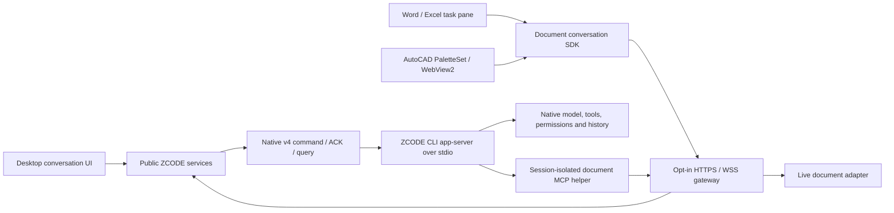

# One ZCODE fork: implementation and acceptance plan

Updated: 2026-10-12. Inspected implementation baseline: `bfede821` on
`dev`. Repository: `D:\Development\ZCode-Harness`, origin
`PortnovAlex80/ZCode`, upstream `zai-org/ZCode`.

Release-base verification on 2026-10-12: upstream annotated tag `v3.15.1` resolves to
`aac4755666d09fdcd70272fcf063c077a639015f`, the fork's original base commit. The local
official fallback installer `C:\Users\user\Downloads\ZCode-3.15.1-win-x64.exe` reports
ProductVersion `3.15.1` and FileVersion `3.15.1.8093`. It is a fallback executable,
not source input to patch or extract for our build. Our fork adds commits to the tagged
source; this does not imply byte-identical binaries or official signing credentials.

This document defines the target and work order. The [checklist](IMPLEMENTATION-CHECKLIST.md)
is the active status and evidence record. The [team prompt](AGENT-TEAM-PROMPT.md)
is the reusable execution brief. Historical investigations remain supporting material,
not competing implementation plans.

## Goal and the meaning of the fork

### GPT по подписке ChatGPT (план от 2026-10-15)

По запросу пользователя подготовлен [план интеграции ChatGPT subscription](CHATGPT-SUBSCRIPTION-PLAN.md)
на русском: официальный Sign in with ChatGPT, собственная регистрация ZCode Harness,
GPT в штатном селекторе и существующий ZCode runtime. Интеграция добавляется в этот
единственный поддерживаемый fork; отдельный постоянный Preview-продукт не нужен.
План определяет соблюдение допуска, scopes и лимитов, исключает обходы и не обещает
нулевой риск блокировки. Задачи GPT-00..GPT-08 находятся в checklist и пока открыты.
Это документация будущей реализации; текущий runtime gate не изменён.

### Current desktop-window refinement (2026-10-15)

For U-06/U-07, [FLOATING-WINDOWS-REFACTOR-PLAN.md](FLOATING-WINDOWS-REFACTOR-PLAN.md)
is the current bounded plan, replacing earlier PiP-only/shared-slot requirements.
The requested chat/discussion windows are native desktop surfaces attached to the
existing Host, movable across monitors, with explicit UI-state/ownership handoff.
The 2026-10-13 retirement remains historical: this narrow new work does not restore
project-window commands or Office/CAD integrations. Earlier references below to those
retired capabilities do not expand the new task. Implementation and live acceptance
remain open. Planning does not authorize launch, install, profile access or merge.

Deliver **one maintained ZCODE application**, built directly from this fork, with our
document workflow, detachable views and native document integrations. Keep the actual
ZCODE agent engine, providers, permissions, CLI history, workflows and project catalog.
The user should operate one application and one normal machine-local profile.

The fork replaces applying an external source overlay to another checkout. Our changes
become ordinary source modules and reviewed commits, using current public contracts and
upstream components. Do not patch an installed ASAR, inject the old overlay at build or
start time, maintain a second product, or introduce an alternative agent backend.
`D:\Development\spec-harness` is a read-only reference for requirements and migration
comparison; its standalone/OpenCode implementation is outside this delivery.

Branch policy: exactly `master` and `dev` in the fork, locally and on origin.
`master` is GitHub's default branch and holds the original v3.15.1 base until a fork
version is accepted; `dev` contains all current changes and is the working branch.
Integrate upstream into `dev` by reviewed merge. Promote accepted `dev` to `master`
with a fast-forward; do not rewrite published history or create permanent task branches.
The old `main` / `research/spec-harness` refs were renamed without losing commits.

The official installer is the user's fallback if the fork is unsatisfactory. We do not
need to maintain a second installed build for that fallback. Protect user data across
schema changes: reinstalling an application alone does not reverse a profile migration.
Retiring obsolete launchers/builds is a final migration action after acceptance, never an
instruction to delete active profiles or unrelated projects during development.

## What research established

| Finding                                                                                | Consequence for implementation                                                                                                                      |
| -------------------------------------------------------------------------------------- | --------------------------------------------------------------------------------------------------------------------------------------------------- |
| The fork contains desktop, UI, services, shared protocols and `apps/zcode-cli` source. | Fix ownership, rendering and transport at their source boundaries instead of editing a generated application.                                       |
| `SessionPane` renders a conversation; it is not the agent or a transport server.       | Native host UIs connect below the pane to the same command/projection contracts.                                                                    |
| The old preview loaded its renderer through Vite development mode.                     | Production build and start must remain separate; shipped start must never depend on Vite/HMR.                                                       |
| Detach creates another renderer and mounts its conversation again.                     | Retain the existing Host/session; measure loading and hydration. React layout separation does not mean a live native view can simply be pulled out. |
| Highlight/diff pools are renderer-local and eager.                                     | A two-worker auxiliary budget already limits cost; lazy/shared ownership remains a measured optimization task.                                      |
| Conversation history is already virtualized, and width changes require remeasurement.  | Preserve virtualization and correct heights; optimize redundant work after tracing it.                                                              |
| Office and AutoCAD expose live-document APIs.                                          | Add native selection, location, proposal and application tools; avoid rewriting open DOCX/XLSX/DWG files behind their applications.                 |
| Native v4 admission, ACK/query and replayable projections already exist.               | Reuse these contracts; do not invent another token stream, accepted-command queue or model client.                                                  |

These findings identify work and architectural opportunities. They are not a measured
claim that all rendering delays have disappeared. Production profiling and live model
acceptance remain open.

## Product rules

1. Preserve three context lanes. Project chat continues its selected project session.
   Side conversation uses the native branch operation and inherits parent context.
   Independent discussion creates a fresh session with explicit project binding,
   document identity/path where available, the selected fragment/snapshot and user
   request. It does not copy parent chat history or silently attach the whole document.
   Normal engine policy/system instructions and explicitly permitted model settings
   remain available; additional document reads must be explicit tool operations.
   The only durable marker of a document-created session is the persisted gateway
   binding (`sessions` plus the bounded `creations` ring); no marker is written into
   CLI session state, and binding membership changes only through the pane — creation,
   acknowledged deletion, or failure-driven retraction (frozen in
   [DOCUMENT-HOSTS.md](DOCUMENT-HOSTS.md), "Заморозка границ диалога").
2. Use native composer, model/mode selection, permissions, tools, questions, streaming,
   stop and workflows wherever supported. An independent draft shows the native form
   before its first Send. Creating an empty session must not call the model.
   A capability the document pane does not yet carry (old-history pagination, file
   attachments, model picker) is shown as explicitly absent with the reason it is
   absent; a fake, dead or silently missing control is a defect, not a degraded mode.
3. Open doc is accessible whenever a workspace can resolve project documents; no
   unexplained requirement to send a chat message first. Preserve file, draft, conflict,
   scroll, pane geometry and project-collapse state according to workspace/session
   identity. Document expansion changes the layout, not the running agent.
4. An OS window and an in-renderer floating card are different placements. Roles and
   Return/Close behavior must be clear. Moving or closing a view must not start another
   agent, cancel a run, duplicate a composer, or strand a draft. The one-composer rule
   has two frozen regimes: exclusive transfer inside desktop (exactly one renderer
   mounts the panel; detach/return refuse during composition or pending attachments
   and acknowledge only after explicit cleanup completes), and observation between
   desktop and a document pane (no transfer exists or is claimed; the CLI per-session
   admission is the single serializer, each surface renders the native admission
   verdict and holds only its own drafts).
5. Git owns source-file change history. Word owns revisions/comments and native apps
   own their contents. Do not add a persistent diff/proposal database. Small routing,
   presentation and unresolved-command identifiers serve different purposes and must
   have explicit retention. Current in-memory proposals do not survive reconnect.
6. Word/Excel keep their ribbons, document/grid, selection and native commands. AutoCAD
   keeps its drawing, native palette behavior and command context. Familiar ZCODE
   conversation controls live inside these hosts, with host themes and compact layout.
   Demo answers or decorative controls cannot stand in for working agent features.
7. One product/core does not mean exactly one OS process. Preserve upstream window-
   scoped Hosts and legitimate workspace/runtime isolation. An auxiliary view attaches
   to the existing owner; it does not create a competing owner of the same session.
   Shared-profile builds must not be run concurrently as independent writers.
8. Session retraction from persisted document bindings is failure-driven: a session id
   leaves the binding only on structured not-found signals (subscribe fault
   `fault.subscribe.sessionNotFound`, rejected ACK `proto.sessionNotFound`, or deletion
   acknowledged through the pane); other failures never retract, and the pane must show
   "this thread no longer exists" when a restored binding session fails on first open.
   An eager sessions-index subscription stays a deferred option gated on a public
   services session-lifecycle feed; the gateway keeps no session store of its own.
9. Reconnect clears ephemeral document anchors: pane-side quotes, the read selection
   and context-pending state never cross a connection generation or document-instance
   change; after reconnect a fresh explicit selection read is required before context
   can be attached again. Decisions, tradeoffs and the derived next-wave code tasks are
   frozen in [DOCUMENT-HOSTS.md](DOCUMENT-HOSTS.md), "Заморозка границ диалога".

## State ownership and the CLI path

| State or responsibility                                       | Owner / boundary                                              |
| ------------------------------------------------------------- | ------------------------------------------------------------- |
| Window lifecycle, placement and handoff coordination          | Electron Main; platform interface injected into UI            |
| Host attachment, route, lease and connection generation       | Existing Host/services and their public contracts             |
| Accepted commands, session execution, permissions and history | Native CLI/runtime; `CommandInbox` admission                  |
| Drafts, scroll, selected tabs and layout                      | UI presentation state, scoped by stable identity              |
| Verified Markdown file write                                  | `SpecDocumentService` with expected content hash              |
| Unsaved Office/CAD content and native edit                    | The selected live document instance and its adapter           |
| External document connections and bindings                    | Opt-in gateway in the existing Host; no second accepted queue |

Code anchors: `packages/services/src/zcode-agent/zcodeAgentProcessManager.ts` launches
`app-server --stdio`; `zcodeAgentService.ts` handles native command/session operations.
`packages/desktop/src/host/documentGatewayAgent.ts` dispatches allowed document-session
commands, preserving existing MCP configuration. `packages/ui/src/document-host/client.ts`
uses native conversation transport and projection. `SessionPane` is a consumer of these
boundaries, not the destination server for Office.

Desktop's continuous attachment and external replayable document connection are distinct
delivery modes. Reconnect needs snapshot/resync and query by the original command ID.
Losing an ACK cannot be interpreted as idle or permission to repeat a write/prompt.

## Current baseline and honest limits

| Area                       | Implemented / previously checked                                                                                    | Still required                                                                                                           |
| -------------------------- | ------------------------------------------------------------------------------------------------------------------- | ------------------------------------------------------------------------------------------------------------------------ |
| Fork and production launch | Source migration, public platform bridge, separate build/start, output hashes, original icon assets                 | Complete runtime preparation, clean-machine installation and live launch acceptance                                      |
| Markdown workflow          | File service, selection actions, independent native discussions, watcher/presentation state, deletion and expansion | Current-fork screen inventory and live restart/conflict/context tests                                                    |
| Detached views             | Coordinator, readiness events, lazy business entry, handoff/return tests with fake Electron                         | Real GUI ownership, Return/X/crash, drafts/attachments, two monitors/DPI and content-readiness timing                    |
| Rendering                  | Auxiliary worker ceiling, visible timers and completed-group caches                                                 | Measured baseline, eager worker reduction, resize/stream/hidden-window profiling                                         |
| Common document transport  | Opt-in gateway, native SDK, session-isolated MCP, strict CA trust, limits and reconnect handling                    | Real Host/CLI/model/permissions/stop/recovery acceptance and explicit desktop/document composer policy                   |
| Word / Excel               | Shared task pane and native adapter fixtures: Word 8 native + 3 UI checks; Excel 7 native + 3 UI checks             | Full usable conversation controls/history, project-session selection policy, GUI input/menu behavior and live agent loop |
| AutoCAD                    | net48/x64 plug-in compiles against installed 2024 SDK; 14 CoreConsole native checks                                 | GUI NETLOAD, WebView/palette/focus/cancellation and live agent loop                                                      |

At `bfede821`, root typecheck passed, lint reported 67 existing warnings and no errors,
the changed-module architecture gate and affected pre-push checks passed, and production
output was validated. Functional/native fixtures and production output refer to that
recorded baseline. This documentation update reruns root typecheck/lint and checks
document formatting, links and the diff; it does not rerun native fixtures, launch GUI
or certify live behavior.
The architecture gate does not cover every desktop boundary. Root typecheck does not
by itself prove all renderer/Main configurations or native host behavior.

The common document pane is currently a thin client with native history-window projection,
tools, reasoning, permissions and the shared question-answer builder. It does **not**
yet have every desktop dialog, old-history pagination or workflow configuration. Its
general document chat is a binding-specific session, not a full project-catalog view.
Do not claim complete SessionPane parity merely from shared styling or transport. The
frozen boundary decisions for one-composer policy, binding markers, session retraction,
pagination/attachments/model-picker parity and reconnect anchor clearing live in
[DOCUMENT-HOSTS.md](DOCUMENT-HOSTS.md) ("Заморозка границ диалога"); until the code
tasks derived there land, those capabilities must render as absent with their reason.

## Delivery phases and dependency order

| Phase                                     | Work                                                                                                                                                             | Exit gate                                                                                          |
| ----------------------------------------- | ---------------------------------------------------------------------------------------------------------------------------------------------------------------- | -------------------------------------------------------------------------------------------------- |
| P0 — establish the baseline               | Read specs/source, reconcile status, map requirements to checklist IDs, assign exclusive paths                                                                   | Current scope, owners and evidence are explicit; no live runtime changed                           |
| P1 — finish desktop correctness           | Audit persistence, three context lanes, native draft readiness, deletion, handoff, Return/X and role labels                                                      | Focused regressions and root integration pass; GUI cases remain explicit until executed            |
| P2 — profile and optimize rendering       | Use isolated replay fixtures first; separate shell load, history hydration and interactivity; improve only measured costs                                        | Correctness preserved; reproducible before/after evidence; live-only results gated                 |
| P3 — unify document conversation surfaces | Small public conversation boundary, native action/interaction reuse, complete required controls/history, explicit project/session binding and composer ownership | No alternate engine or second queue; screen/action parity and refusal/recovery tests pass          |
| P4 — complete native host integration     | Word comments/track changes and anchors, Excel bounded formula/value writes, AutoCAD installed GUI deployment; harden identity/reconnect/apply                   | Native operation fixtures pass; installation and real GUI checks recorded separately               |
| P5 — end-to-end acceptance                | Once runtime is available, production fork, real native commands/tools/permissions/stop, context isolation, windows, Office/CAD and profiles                     | All release-blocking checklist items have actual evidence or an explicitly narrowed approved scope |
| P6 — one supported release                | Build/install/update instructions, normal local auth/profile, icon/taskbar, obsolete launcher retirement and upstream update procedure                           | User can build/run one fork on this and another machine; fallback/data recovery documented         |

P1 and read-only P2 baseline analysis can proceed independently. Do not optimize an
unstable handoff by increasing timeouts. P3 public contracts precede dependent UI/adapter
edits. P4 adapter work can be parallel after these contracts are frozen. P5 requires
P1/P3/P4 integration; P6 cannot certify features whose live gates are still open.

The default detachable-window strategy remains the current shared-owner renderer
approach. Prototype a retained `WebContentsView` only if measurements show remount cost
dominates and the focused experiment preserves Host routing, focus/IME, overlays, CUA,
DPI and close ownership. Neither such a prototype nor a global worker pool is required
just because the UI regions look separated.

## Team and validation rules

Root owns scope, public contracts, cross-package wiring, integration, checklist statuses,
commits and pushes. At most three subagents run concurrently. Every path has one writer,
including root. Read-only investigation may overlap. Each bounded implementation gets
a separate reviewer of a stable diff. Team assignments and verification evidence live
in the checklist; avoid a parallel task journal.

Follow this repository's `AGENTS.md`, nested instructions and architecture skill. Verify
current commands in `package.json`. For implementation changes, use focused meaningful
checks, root typecheck/lint/changed architecture/affected pre-push checks and production
build at the integration boundary. Native acceptance uses disposable owned fixtures;
it must not close a user's Office/CAD session. GUI/model evidence is a distinct gate.
Do not repeat unrelated suites when no new change or failure justifies it.

## Windows installer delivery

`Build-Harness.cmd` must rebuild and stage the current Agent CLI together with official plugins and their native runtime closure before compiling production output for source-checkout launch; its freshness receipt covers CLI sources as well as desktop sources. A UI-only rebuild must not silently retain an old authentication/inference runtime. The complete agent preparation entrypoint must restore plugin dependencies after CLI staging clears the bundle directory.
It does **not** create an installer. Upstream already provides
`packages/desktop/scripts/bundle.mjs` and `electron-builder.config.js`, including a
Windows x64 NSIS target, runtime-dependency validation and artifact-size audit.
The existing command shape is `pnpm bundle:desktop -- --os win --arch x64`.
It still needs fork-specific integration and acceptance before becoming our release path.

Implement a single root wrapper, proposed `Build-Installer.cmd`, with these semantics:

- From any working directory, resolve this checkout, enforce pinned tools/target,
  prepare missing dependencies/runtime assets and build the actual fork revision.
- Reuse upstream bundling/NSIS rather than introducing another packaging stack.
  Explicitly choose production backend/one installed product identity. Include the
  correct CLI, native dependencies, preload, lazy chunks and original icon assets.
- Enable the accepted fork features in the packaged application itself. A user opening
  the installed EXE must not need `ZCODE_SPEC_HARNESS_WINDOWS=1` supplied by a source
  launcher. Document gateway pairing remains separately opt-in.
- Do not launch Electron, install the artifact, publish it, change profiles or replace
  a live installation during build. Return a failing exit code on preparation/build/
  packaging errors. Print the absolute installer path, revision/version and SHA-256.
- Distinguish upstream base version from fork revision in metadata and artifacts.
  Ship no credentials, source checkout, node_modules development cache, logs or private
  certificates. Define separate installation/setup for Office/CAD components; do not
  claim the desktop installer alone sideloads every native host integration.
- Provide a normal full build and a fast repeated-build path using verified caches.
  Skip preparation/build only when target, source, assets and output validation allow it.
  First build may need downloads; do not promise constant build time or byte-identical
  signed binaries. Signing is optional local configuration, never assumed available.
- Define a fork-safe update policy: official automatic installation must not silently
  overwrite the fork's features. Upstream source updates are reviewed, built and
  accepted; installing the official product is an explicit fallback choice.
- Verify actual generated installer resources/runtime closure, install/upgrade/uninstall
  and reuse of a normal profile in an isolated authorized environment before replacing
  the user's version. Preserve the profile and record schema compatibility/data recovery.

Installer delivery is tracked by R-08..R-10 in the checklist. The wrapper is planned,
not implemented by this documentation update.

## Runtime gate and later work

**Current gate: ZCODE is busy.** This plan/prompt authoring does not authorize starting,
stopping, restarting or modifying the active ZCODE, installed source-runtime, shared
profile, launch shortcut or accepted sessions. Code, docs and isolated builds/tests in
the fork may proceed when implementation is requested. Use process-local opt-in gateway
configuration only for the later authorized acceptance launch. No paid model requests
as routine verification.

The compact agent reference map for Word/Excel/AutoCAD is a **separate follow-up**, already
recorded in [DOCUMENT-HOSTS.md](DOCUMENT-HOSTS.md): object → operation → limits → minimal
example, a short versioned startup index plus lazy resources. Do not build a large API
encyclopedia or add broad VBA/LISP execution to this implementation batch. An upstream
proposal may be prepared from accepted source changes later; do not send it without an
explicit request.
