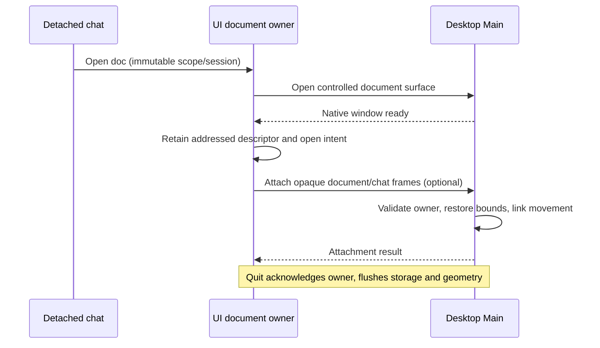

# Independent document windows

Date: 2026-10-18. User requested independent documents optionally attached to a
detached conversation. Extends persistent conversation windows; ADR 005.

## User path

Desktop Open doc opens a complete independent document window, including the
unbound file picker, editor, metadata and discussions. A stable portal retains
one editor owner; no document body or transcript is copied into a new renderer.
The document stays usable while the main shell selects another conversation or
project. Its identity is immutable workspace + parent session + tab. Opening an
existing document tab reveals its existing window. Sidebar session selection
reveals its chat and any open document windows without hiding their owner tabs.
Changing files in an inactive-project window updates the retained descriptor and
saved owner tab; Return and restart restore the latest file, preserving other tabs.

The document header offers Attach to conversation when its addressed parent has
an open detached chat. Attach places the two independent windows beside each
other; moving either moves its partner, resizing maintains adjacency. Detach
leaves both independently positioned. Attachment never starts or changes a run.
Closing/returning either surface does not close its partner. Maximized, minimized,
fullscreen or unfit pairs suspend positioning; monitor recovery keeps windows
reachable. No drag-to-edge magnet or native reparenting is required.

Native X/Return returns the document to its saved owner tab and clears its desired
open flag. The inline anchor can reopen it. Reload/quit preserves desired open
intent. File path, document draft, active discussion, geometry and optional parent
attachment restore across reload/restart, including inactive projects. Existing
discussion-only popouts keep distinct keys; retain a tab while either surface is
detached. Web keeps its existing presentation behavior.
Context-usage hover cards and other document portals use the actual presentation
document, so detached triggers and popup coordinates share one window.

## Owners and event order

UI retained descriptors own desired open surfaces and attachment intent; Main
owns native geometry and live grouping. The optional platform attachment command
accepts logical document/conversation identities; Desktop hashes them to opaque
frame names. Main authorizes both controlled children against the sending owner.
No arbitrary native IDs, coordinates, child preload or navigation capability.

Acceptance: detached chat Open doc; choose/edit original project document while
main shows another project; sidebar reveals original surfaces; attach, move both
directions, detach; reload and full cold restart; independent closes; document and
discussion-only popouts coexist; no model prompt or user-profile mutation.
