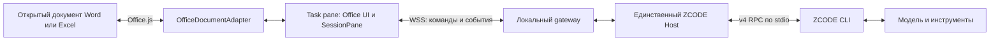

# Word / Excel: другой интерфейс, то же ядро ZCODE

Статус: исторический план исследования от 12 октября 2026, составленный до реализации gateway и native document tools. Описанные ниже предположения не являются текущим статусом продукта. Реализованный объём и ограничения: [DOCUMENT-HOSTS.md](DOCUMENT-HOSTS.md); актуальные задачи: [план](IMPLEMENTATION-PLAN.md) и [чеклист](IMPLEMENTATION-CHECKLIST.md). Живая приёмка через работающий ZCODE ещё открыта.

## Решение после перехода на fork

Использовать штатный контейнер task pane Word/Excel и компактный React-интерфейс на основе компонентов ZCODE. Ядро исполнения, сессии, модели, разрешения и инструменты остаются в одном ZCODE Host/CLI. `SessionPane` — UI, а не сетевой сервер: подключаемся к сервисам/транспорту под ним. Полный Electron Root и второй backend для каждого документа не нужны.

Office Add-ins предоставляют task panes с HTML/JS внутри Office и Office.js API для документа. Это нативная точка размещения панели, но её содержимое — webview. VSTO custom task pane с COM/WebView2 остаётся Windows-альтернативой, если spike покажет недоступность обязательных Office.js операций. Возможности Office.js проверяются по requirement sets установленной версии. [Office Add-ins overview](https://learn.microsoft.com/en-us/office/dev/add-ins/overview/office-add-ins), [Task panes](https://learn.microsoft.com/en-us/office/dev/add-ins/design/task-pane-add-ins), [Requirement sets](https://learn.microsoft.com/en-us/office/dev/add-ins/develop/office-versions-and-requirement-sets).

Стрелка Office.js — работа с живым документом, не файловый I/O. Вызовы модели остаются штатными; новый канал не является вторым LLM transport. WSS — предложенный канал для локальной интеграции, его доступность в конкретном Office WebView необходимо проверить на spike.

## Что уже найдено в исходниках

| Граница              | Реальная опора                                                                                  | Что ещё потребуется                                                                               |
| -------------------- | ----------------------------------------------------------------------------------------------- | ------------------------------------------------------------------------------------------------- |
| UI беседы            | `packages/ui/src/v4/SessionPane.tsx`                                                            | Минимальный Office root, providers, ограничения capabilities, узкая компоновка                    |
| Данные и команды     | `v4/transport.ts`, `V4ConversationContext.tsx`, `agentConversationTransport.ts`                 | Office bootstrap над тем же контрактом, без Electron globals                                      |
| Browser RPC          | `packages/client/src/websocket.ts`                                                              | Authenticated Office endpoint и ограниченный service accessor                                     |
| Существующий Host    | `packages/desktop/src/main/webRemoteControlSharedHostAttachments.ts`                            | Локальное attachment/ownership API для Office; существующий cloud relay не обязательный компонент |
| CLI admission        | `packages/services/src/zcode-agent/zcodeAgentService.ts`, `zcodeAgentProcessManager.ts`         | Сохранить `v4/command`, ACK/query и `app-server --stdio`                                          |
| UI-provided tools    | `packages/shared/src/mcp-apps/appTools.ts`, AgentService register/claim/resolveAppToolCallForUi | Office registration adapter; сейчас path требует plugin/server/instance/scope и generation        |
| Независимый контекст | `spec-document/useSpecDiscussion.ts`, `specThread.ts`, `SpecDiscussionPane.tsx`                 | Office document identity и fragment snapshot вместо обязательного локального пути                 |

`ConversationTransport` уже отделяет desktop MessagePort от WebSocket relay. В текущем server `/ws` — клиентский replayable режим; `/ws/host` требует специальную host capability. Браузерная панель Office не должна получать роль trusted Host. Самостоятельный запуск существующего server поверх того же профиля не гарантирует общий owner с desktop.

## Владельцы состояния и границы

| Состояние                                                 | Единственный owner                                                  |
| --------------------------------------------------------- | ------------------------------------------------------------------- |
| Принятая команда, сессия, выполнение, история, разрешения | ZCODE Host/CLI                                                      |
| Регистрация Office подключения и document capabilities    | Gateway в жизненном цикле того же Host                              |
| Содержимое несохранённого документа/книги                 | Word/Excel                                                          |
| Применение разрешённой операции Office                    | OfficeDocumentAdapter выбранного document instance                  |
| Черновик ввода, вкладка, scroll, локальная подсветка      | Office UI                                                           |
| Право активного composer/применения document tool         | Host-owned lease с connection generation; UI только предъявляет его |

Desktop и Office могут наблюдать один проект. Для одновременного просмотра одной сессии нужна явная политика composer ownership: второй view наблюдает или получает lease через передачу; локальная JS Map нашего current renderer не обеспечивает exclusivity между Office и Electron. Нельзя создавать две принятые очереди или давать двум поверхностям неявно владеть одним write-operation.

Первый вариант использует работающий desktop Host. Позднее возможен companion/headless owner для Office без открытого desktop, но с единственным владельцем профиля и согласованным handover. Закрытие task pane удаляет подписку/Office capability, не отменяет агентную сессию; выход owner Host — другая операция.

## Контексты

| Действие                    | Передаваемый контекст                                                                                |
| --------------------------- | ---------------------------------------------------------------------------------------------------- |
| Открыть проектный чат       | Явно выбранная существующая сессия проекта                                                           |
| Продолжить в боковой беседе | Штатный fork существующего контекста                                                                 |
| Обсудить выделение отдельно | Новая сессия, project binding, identity/имя документа, optional path/URL, fragment snapshot и вопрос |

Новая независимая дискуссия не получает историю родителя и весь документ. Настройки модели передаются отдельно по whitelist. Несохранённый Word/Excel документ может не иметь локального пути; `documentId` и `documentInstanceId` обязательны независимо от path. Документ OneDrive/SharePoint не считается локальным файлом по URL. Привязка к проекту задаётся явно, а не угадывается по имени файла.

## Канал и восстановление

Для MVP выбрать HTTPS-страницу панели и authenticated WSS к локальному gateway; HTTP POST + SSE остаётся альтернативой, но bidirectional tools удобнее обслуживать в одной connection. Использовать существующий RPC framing/версии ZCODE, а не новый формат chat tokens. HTTPS требуется для Office add-ins, включая разработку; loopback/certificate/browser policies проверяются отдельным spike. [Word quickstart](https://learn.microsoft.com/en-us/office/dev/add-ins/quickstarts/word-quickstart?tabs=yeomangenerator).

Gateway слушает loopback, разрешает известные origins и выдаёт ограниченную connection capability после pairing. Office UI не получает provider credentials, доступ ко всему профилю или Node filesystem. Не использовать общий долгоживущий token в URL; отдельно спроектировать browser-compatible handshake без произвольных headers WebSocket. Результат Office tool не должен направляться другому document instance после navigation/reopen.

Команды имеют штатный `commandId`. При потере ACK выполнять query/reconciliation; отсутствие ответа не означает, что команду не приняли. Для UI подключение replayable с snapshot/resync и gap repair; профиль доставки выбрать явно, не наследовать `desktop-continuous` только из-за общего компьютера. ACK подписки должен предшествовать публикации накопленных events. Office-specific tool calls остаются live-only и не воспроизводятся как история.

После reconnect проверять Host/session identity и новую connection generation. Не повторять автоматически prompt или write. Office Tool registration выполняется только для конкретной открытой книги/документа; при закрытии instance его lease и write-capability отзываются. Повторное открытие панели восстанавливает историю; не переносит старый proxy Range в новую Office.run context.

## Живые Office tools

Первая фаза только читает выделение и обсуждает его. Для правки нужен обратный канал: модель вызывает ограниченную document operation, gateway доставляет её add-in, OfficeDocumentAdapter применяет Office.js и возвращает проверенный результат. Возможная основа — существующие App-Provided Tools; registration и lifetime не считать готовыми для Office.

Будущий контракт операции включает `operationId`, `workspaceIdentity`, `sessionId`, `documentId`, `documentInstanceId`, `connectionGeneration`, target anchor/range, expected content/hash, operation type и bounded payload. В Word snapshot содержит выбранный текст и контекст якоря; в Excel — sheet identity, range, values, formulas, размеры и типы. Values и formulas не взаимозаменяемы; формат/локаль определяются явно.

Перед записью adapter повторно разрешает target и проверяет содержимое. Это оптимистическая проверка, а не обещание атомарного CAS Office.js: параллельный пользователь/соавтор может изменить документ между чтением и записью. `context.sync()` пакетирует Office операции, но не делает arbitrary batch транзакцией. Проверять postcondition; частично выполненную/неподтверждённую запись сообщать как частичную/unknown, не replay. [Office API model](https://learn.microsoft.com/en-us/office/dev/add-ins/develop/application-specific-api-model).

Для MVP использовать узкие операции read selection, insert/replace разрешённого фрагмента и bounded Excel range edit. Показать предложение и цель применения; объём разрешений согласуется с штатным режимом агента. Undo/track changes и конкретные anchors проверяются по поддерживаемым API; не обещать единую транзакционную отмену до spike. До принятия правок разрешён read-only режим.

Не перезаписывать открытый DOCX/XLSX filesystem tools параллельно Office writer. Файловые document-skills сохраняются для создания отдельных артефактов/экспорта, а не синхронизации живого буфера. Для Office buffer Git не заменяет Undo и AutoSave; не добавлять собственный архив диффов. Ограниченная операция/receipt для reconciliation — не версия всего документа.

Если pane закрыта, инструмент сообщает unavailable; pending write не ждёт неопределённо. Native App-Provided Tools сейчас имеют claim timeout 5 с и execution timeout 30 с; пользовательское длительное подтверждение нельзя скрыто поместить внутрь этих сроков. Необходимы отдельный admission/approval шаг или согласованное изменение контракта. Таймаут после применения требует сверки результата, не слепого повтора.

## Решение между вариантами

Архитектурная развилка: complicated. Оценки 1–5 являются инженерными гипотезами, не бенчмарком. Веса: корректность/ownership 35%, reuse 25%, переносимость 15%, стоимость 15%, обратимость 10%.

| Вариант                                       | Корректность | Reuse | Переносимость | Стоимость | Обратимость | Итог |
| --------------------------------------------- | -----------: | ----: | ------------: | --------: | ----------: | ---: |
| A: Office.js + capability-limited SessionPane |            4 |     5 |             4 |         3 |           4 | 4,10 |
| B: Office.js + новый тонкий chat UI над v4    |            4 |     3 |             4 |         4 |           5 | 3,85 |
| C: Windows VSTO/COM + WebView2 + общий Host   |            4 |     4 |             1 |         2 |           3 | 3,15 |

Выбираем A как обратимый spike: сначала документный контейнер и read-only сценарий, затем оценка переносимости компонентов. B — резервный вариант, если SessionPane требует слишком много desktop providers/тяжёлых возможностей. C — вариант для обязательных Windows-only функций COM. Разница A/B небольшая, поэтому не переносим весь Root ради формального reuse. VSTO ограничен Windows и несёт отдельную установку/bitness/COM lifecycle. [VSTO custom task panes](https://learn.microsoft.com/en-us/visualstudio/vsto/custom-task-panes?view=vs-2022).

Pre-mortem: второй Host конфликтует с профилем; неточное anchor меняет чужой текст; pane закрывается во время записи; SessionPane перегружает узкую панель; HTTPS/loopback не работает в целевом Office. Меры: единственный owner, capability binding, stale refusal и postcondition, reconciliation unknown results, минимальный root и профилирование, транспортный spike до UI migration.

Независимое red-team ревью: оценка reuse=5 оптимистична, поскольку SessionPane зависит от широкого service accessor, store, media/attachments и plugin среды. Capability flags сами по себе не делают его готовым к Office. Обязательный gate — минимальный OfficeSessionRoot, который доказывает createSession → snapshot/events → send → permission → stop → reconnect без эмуляции половины desktop. Если gate не пройден, выбрать B и переиспользовать composer/timeline отдельно. Переносимость Office.js не означает переносимость локального companion на все Office платформы; MVP ограничить подтверждённой конфигурацией desktop. Document write policy должна учитывать и Office tools, и штатные CLI filesystem tools, иначе один adapter не обеспечивает одного writer.

Ожидание решения: reuse должен сохранить штатные cancel/permissions/tools и три контекста без второй принятой очереди и без попадания provider credentials в Office. Проверочный trigger — завершение connectivity/read-only spike на конкретной версии Word и Excel. При невозможности этих условий переходить к B/C, а не обходить ownership.

## Этапы и приёмка

1. **Connectivity spike.** Определить supported Office builds, проверить manifest/HTTPS/loopback/WSS, document instance и доступ к одному существующему Host. Никаких живых профилей в автоматическом исследовании.
2. **Публичные contracts.** OfficeSessionPort, OfficeDocumentPort и Host attachment/lease; выделить `@zcode/ui/office-pane` public entrypoint, `packages/office` adapter/bootstrap без Electron. Описать API requirements и refused capabilities до реализации.
3. **Word read-only MVP.** Выделение → новый независимый чат → stream/stop/permissions → закрыть/открыть pane → та же история. Полный документ не передаётся неявно. Модель и инструменты ZCODE штатные.
4. **Word writes.** Один узкий insert/replace, stale target refusal, preview/approval, postcondition, uncertain-result reconciliation и подтверждённая Undo-семантика. Инструмент не работает при закрытом документе.
5. **Excel.** Read range с values/formulas отдельно; затем ограниченная запись. Защищённые, merged/large/multi-area ranges и соавторство имеют явные пределы/отказы.
6. **Контексты и общий UI.** Подключить проектный чат и Side conversation, проверить одновременный просмотр desktop/Office, ownership transfer без duplicate send; адаптировать компактность UI, media/tools и загрузку workers по необходимости.

Приёмка включает reconnect до/после ACK, document switch и одинаковые имена документов, Save As, несохранённый файл, пользовательскую правку во время ответа, закрытие pane/документа, отмену/permissions, stale generation и таймаут после записи. Производительность измерять при вводе Office и stream: idle CPU, startup/first interactive, render commits, Office sync количество/длительность. Не подключать eager diff worker pool или полный workspace shell для простого чата.

Первый результат этой работы — спецификация и архитектурное решение. Реализация интеграции требует отдельного этапа; текущая сборка ZCODE не меняется.
