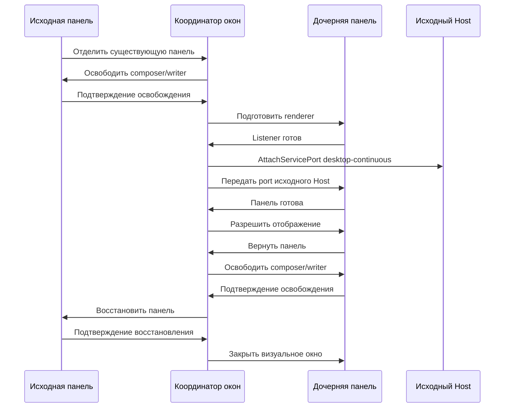

# Spec Harness в форке ZCODE

Рабочий репозиторий: `D:\Development\ZCode-Harness`, origin — `PortnovAlex80/ZCode`, upstream — `zai-org/ZCode`. Начальная версия форка: 3.15.1, `aac4755666d09fdcd70272fcf063c077a639015f`. Источник наших дополнений: `D:\Development\spec-harness`, overlay на `29628c9acdb81b703bbd4080c207a0e7ce5e276e`. Это миграция исходников, а не обновление работающего приложения.

## Границы текущей работы

Разрешены перенос, рефакторинг, установка зависимостей, проверки без GUI и сборка в этом checkout. Electron, E2E с запуском приложения, лаунчер и агентные запросы не запускать. Не изменять работающую сборку в LocalAppData, текущий профиль `.zcode`, ярлык и процессы пользователей. Штатные иконки `packages/desktop/build/icon.ico`, `icon.png`, `icon_windows.png` сохраняются; отдельную авторскую иконку пользователь предоставит позже.

## Поведение, которое нужно сохранить

- Основной чат проекта, штатная Side conversation с наследуемым контекстом и независимая дискуссия документа/фрагмента остаются разными режимами. Новая дискуссия получает путь проекта, ссылку на документ, выбранный фрагмент и вопрос; история общего чата туда не добавляется.
- Open doc, просмотр/правка/сохранение, выбор другого документа, file watcher, восстановление документа и черновика, удаление дискуссии, разворачивание документа и скрытие общего чата сохраняются.
- Передача панели меняет только визуальное размещение. Сохраняются Host, agent/session/run identity, права и единственный активный composer/writer. Потеря исходного Host приводит к отказу, а не созданию замены.
- Side conversation и независимая дискуссия переиспользуют нативный SessionPane. Standalone/OpenCode остаётся в соседнем spec-harness и не становится скрытым fallback форка.
- Состояние принадлежит одному владельцу: Main — окна/передача, Host/runtime — принятые команды и поток, UI — неотправленный черновик и размещение, файловый сервис — проверенная запись с expected hash. workspaceIdentity не заменять одним путём.

## Решение о порядке рефакторинга

Сначала переносим проверенную механику в новую ревизию, сохраняя upstream изменения. Затем уменьшаем холодный запуск renderer, отделяем build от start, заменяем опрос готовности событием и ограничиваем работу подсветки. Перенос живого WebContentsView требует отдельного прототипа: IPC сейчас часто выводит Host owner из BrowserWindow.fromWebContents, а native view меняет visual parent. Его нельзя внедрить только заменой конструктора окна.

Сравнение вариантов: оценки 1–5; веса — корректность 35%, совместимость 25%, потенциал производительности 20%, стоимость 10%, обратимость 10%.

| Вариант                                          | Корректность | Совместимость | Производительность | Стоимость | Обратимость | Итог |
| ------------------------------------------------ | -----------: | ------------: | -----------------: | --------: | ----------: | ---: |
| A: перенести дополнения, затем улучшать загрузку |            4 |             4 |                  3 |         4 |           5 | 3,90 |
| B: сразу заменить панели живыми native views     |            2 |             2 |                  5 |         1 |           2 | 2,50 |
| C: оптимизировать upstream, отложить дополнения  |            5 |             3 |                  3 |         5 |           5 | 4,10 |

C нарушает обязательную цель перенести имеющийся функционал; поэтому выбираем A. Это инженерные оценки, не измеренные показатели скорости. Риски: старый patch может затереть plugin/remote/highspeed изменения; новая версия может изменить схему данных; ленивый provider может перемонтировать дерево и потерять черновик; сборка или тест может случайно запустить GUI. Меры: семантическое разрешение конфликтов, проверки текущих публичных контрактов, отказ от открытия профиля в этой работе, тесты без Electron, разделённые команды сборки и запуска. Замечания независимого ревью и фактические результаты дополняются ниже.

## Этапы и критерии готовности

1. **База и зависимости.** Проверить freshness и architecture baseline, читать контролируемый контекст ui/desktop/services/shared. Зависимости ставить по frozen lockfile без запуска lifecycle GUI. Не менять глобальную конфигурацию Node/pnpm.
2. **Совместимость.** Перенести 31 overlay файл и native подключения из manifest через проверяемый three-way merge. Разрешить каждый конфликт в пользу сохранения обеих семантик, не копировать старые App/SessionPane целиком. Снять собственную иконку из исходного переноса, оставить штатный asset. Сохранить предыдущие source-backed проверки и адаптировать их к форку.
3. **Production start.** Нужны отдельные build-only и start-only команды. Start требует готовые production renderer/Main/Host/preload/CLI, очищает dev URL и не запускает Vite. Проверка отсутствующих/устаревших артефактов отказывает до запуска. Штатная иконка используется при любом новом окне; shortcut меняется только после отдельной живой приёмки.
4. **Дочерние панели.** Готовность передавать событием, не 20 IPC запросами в секунду. Тяжёлый business root загружать через небольшой публичный entry с установленным заранее MessagePort listener. Не терять startup admission или update-status окно. Инициализация и Return остаются идемпотентными.
5. **Подсветка/размеры.** Уменьшить дополнительную стоимость detached renderer. Запуск worker pool по реальной потребности требует стабильного дерева: lazy wrapping с remount всего чата не допускается. Виртуализацию и обязательное измерение строк сохранять; исключать только доказанно лишние проходы/анимации. Измеренные гарантии улучшения скорости не заявлять до профиля.
6. **Проверки без запуска.** Focused unit/source tests, typecheck, lint, architecture, production build; сравнить статические renderer chunks и источник eager workers. Указать реальные upstream failures отдельно. Не запускать Electron smoke или E2E в текущей сессии.
7. **Отложенная приёмка.** После отдельного разрешения: cold/warm detach/return, большой чат со streaming, разрешения и отмена, один владелец composer, IME/uploads, два монитора/DPI, восстановление после crash, несколько агентов. Измерить p50/p95 этапов, CPU/heap/paint/layout; успешная сборка не равна устранению всех лагов.

## Текущее состояние

- Форк клонирован, origin/upstream настроены; ветка `research/spec-harness` основана на 3.15.1.
- Freshness прошёл. Зависимости установлены по frozen lockfile без lifecycle scripts и скачивания Electron.
- Дополнения перенесены; конфликты разрешены с сохранением новых upstream plugin/highspeed/workflow и mobile возможностей.
- Оконный bridge инъецируется через IPlatformService и доступен только при включённых Main handlers. IPC готовности заменён подпиской на событие с одной начальной сверкой состояния. Ранний Return сохраняется до завершения передачи.
- Business roots загружаются через отдельные публичные lazy entrypoints после установки MessagePort listener. Detached renderer ограничен двумя diff workers; основной — четырьмя. Workers пока создаются eagerly, глобального разделяемого пула нет.
- Таймер длительности локализован в видимых активных turn groups; поиск и навигатор кешируют завершённые группы. Измерение виртуализированных строк при изменении ширины сохранено.
- Build и Start разделены. Start проверяет отпечаток исходников и всех файлов production output, очищает dev URL и сохраняет штатный выбор профиля. Скрипт сборки не запускает приложение.
- Windows checkout с core.autocrlf менял байты vendored Gen UI и нарушал SHA-256 manifest. Для каталога vendor добавлено `-text`; оригинальные bytes сверены с upstream manifest без изменения ожидаемых хешей.
- Независимое ревью выявило повторное внесение `/plan` в первое сообщение, недостоверную доступность оконных команд и неполную проверку lazy chunks. Эти замечания исправлены; добавлены проверки нормализации и целостности сборки.
- Приложение, сервер разработки и агентные запросы не запускались. Производительность будущей сборки ещё не измерена.

## Ограничения приёмки

Перенос в окно создаёт renderer и повторно монтирует интерфейс, сохраняя Host и сессию. Это не перемещение живого DOM. ACK подтверждает готовность оболочки; скорость полной гидратации истории нужно измерить отдельно. Живой WebContentsView и ленивый общий worker pool остаются следующими этапами после профилирования.

Обязательные root typecheck и lint проходят. Дополнительная отдельная компиляция desktop Main/preload/renderer обнаруживает ошибки конфигурации rootDir, отсутствующих Window.zcode деклараций и типов upstream; полной строгой desktop type-приёмки нет. Architecture gate не управляет всем desktop контекстом, поэтому его успешный результат не доказывает корректность всех оконных границ. GUI/E2E, DPI, отмена агента и восстановление после crash отложены до безопасной живой приёмки.

Инструкция и матрица экранных элементов: [README.md](README.md).

## Проверенная ревизия

- Root `pnpm typecheck` прошёл; `pnpm lint` — 66 предупреждений, 0 ошибок.
- Focused suite: 13 файлов, 64 успешных проверки, 1 пропуск Windows symlink privilege. Node receipt suite: 2 успешных проверки.
- Дополнительно проверены штатные slash commands, поиск, highspeed admission, resize/stability/chrome и remote mobile layout. Mock платформы mobile теста расширен optional capability; поведение и assertions сохранены.
- `architecture:check --changed` — 0 нарушений в пределах управляемого контекста. Независимое повторное ревью трёх исправлений не выявило блокирующих замечаний.
- Production Main/Host/preload/renderer компилируются. Receipt проверяет реальный CommonJS preload `index.cjs` и весь набор чанков; GUI не запускался. Native runtime assets и Electron ещё требуют первичной подготовки по инструкции.
